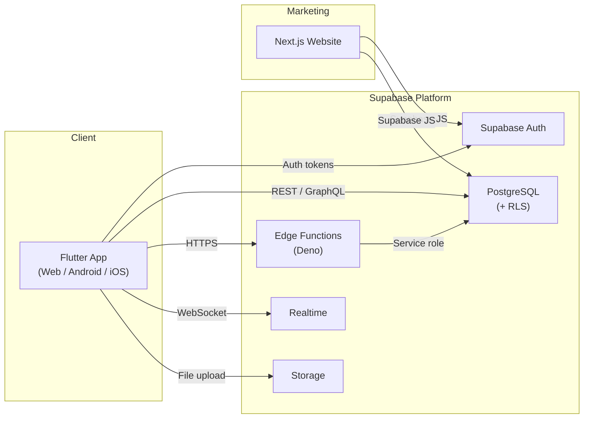
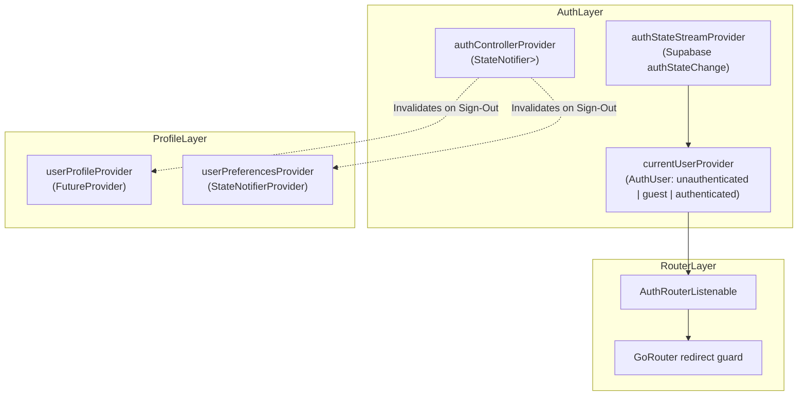
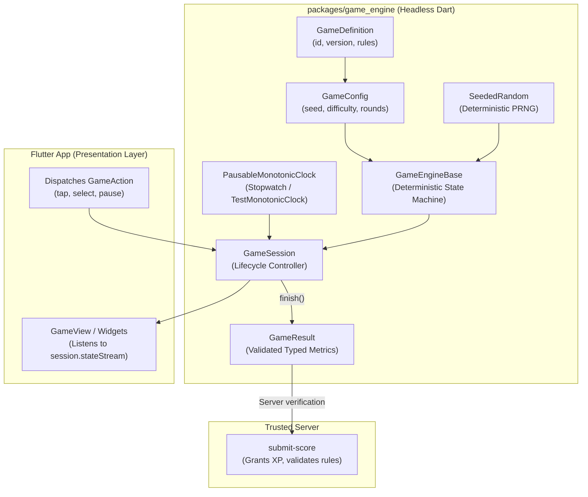
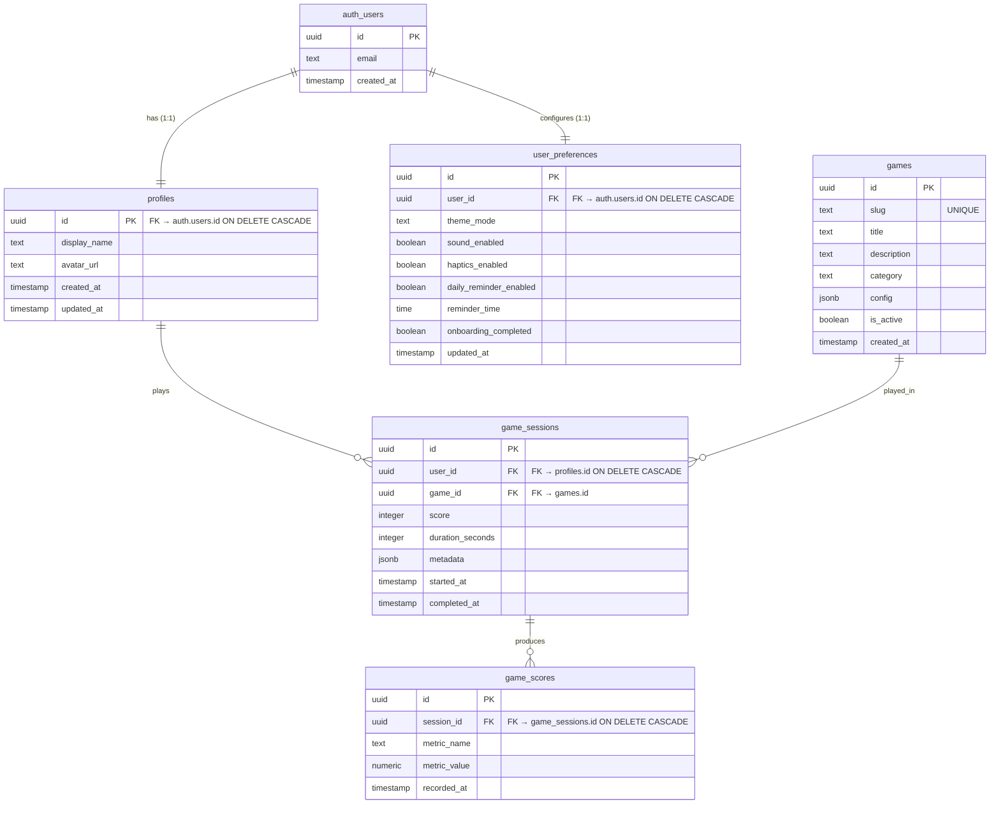

# NEUROPLAY — Architecture

> **Status**: Living document · Last updated: 2026-10-23

## 1. System Overview

NEUROPLAY is a cross-platform brain-training platform. The system comprises three deployable units:

1. **Flutter App** — A single Dart codebase compiled to Web (SPA), Android (APK/AAB), and iOS (IPA).
2. **Supabase Backend** — Managed PostgreSQL database, Auth service, Row-Level Security, Realtime subscriptions, Storage, and Edge Functions.
3. **Next.js Marketing Website** — Server-rendered public site with landing pages, blog, and pricing.



## 2. Flutter App Architecture

### 2.1 Layered Architecture

The app follows a **feature-first** structure with a clean separation into three layers per feature (Data, Domain, Presentation):

```
app/lib/
├── main.dart
├── app/
│   ├── app.dart                  # MaterialApp.router setup & ThemeMode binding
│   ├── router.dart               # GoRouter configuration & AuthRouterListenable
│   └── theme.dart                # Material 3 design tokens & theme data
├── core/
│   ├── constants.dart            # Route constants & table names
│   ├── exceptions/
│   │   ├── app_exception.dart    # Sealed AppException hierarchy
│   │   └── failure.dart          # Equatable Failure value objects
│   ├── network/
│   │   └── supabase_client.dart  # Supabase initialization & PKCE client singleton
│   ├── theme/
│   │   ├── app_colors.dart       # Design system color tokens
│   │   ├── app_spacing.dart      # Spacing, padding, and radii tokens
│   │   ├── app_typography.dart   # Heading, title, and body styles
│   │   └── app_breakpoints.dart  # Mobile, tablet, desktop responsive breakpoints
│   ├── utils/
│   │   ├── logger.dart           # AppLogger wrapper
│   │   └── validators.dart       # Email and password form validation
│   └── widgets/                  # Reusable components (buttons, cards, inputs, dialogs)
└── features/
    ├── auth/
    │   ├── data/
    │   │   └── auth_repository.dart        # IAuthRepository & SupabaseAuthRepository
    │   ├── domain/
    │   │   └── auth_user.dart              # AuthUser entity & AuthStatus enum
    │   └── presentation/
    │       ├── controllers/
    │       │   └── auth_controller.dart    # AuthStateNotifier & auth providers
    │       ├── login_screen.dart
    │       ├── register_screen.dart
    │       ├── forgot_password_screen.dart
    │       └── onboarding_screen.dart
    ├── home/
    │   └── presentation/home_screen.dart
    ├── games/
    │   ├── data/
    │   ├── domain/
    │   └── presentation/games_screen.dart
    ├── progress/
    │   └── presentation/progress_screen.dart
    ├── challenges/
    │   └── presentation/challenges_screen.dart
    └── profile/
        ├── data/
        │   └── profile_repository.dart     # IProfileRepository & SupabaseProfileRepository
        ├── domain/
        │   └── profile_models.dart         # UserProfile & UserPreferences
        └── presentation/
            ├── controllers/
            │   └── profile_controller.dart # ProfileController & PreferencesController
            └── profile_screen.dart
```

### 2.2 State Management & Auth Reactivity (Riverpod)



**Key Principles:**
- **Single Source of Truth**: `currentUserProvider` determines whether the user is `unauthenticated`, `guest`, or `authenticated`.
- **Guest Mode Isolation**: Guests have a local in-memory identity without fake records in `auth.users`. Unauthenticated RLS blocks remote queries.
- **Cache Invalidation**: Upon sign-out or account deletion, `authControllerProvider` invalidates `userProfileProvider` and `userPreferencesProvider` to prevent stale memory leaks.

### 2.3 Navigation & Guarded Routing (GoRouter)

- Routes are organized into public auth routes (`/login`, `/register`, `/forgot-password`, `/onboarding`) and authenticated/guest app shell tabs (`/home`, `/games`, `/progress`, `/challenges`, `/profile`).
- `AuthRouterListenable` notifies `GoRouter` whenever `currentUserProvider` transitions.
- Authenticated or guest users attempting to access `/login` or `/register` are automatically redirected to `/home`.
- Unauthenticated users attempting to access shell routes are redirected to `/login`.

### 2.4 Deep Linking & URL Handling

- Native Scheme: `neuroplay://auth-callback` configured in Android (`AndroidManifest.xml`) and iOS (`Info.plist`).
- Flutter Web redirect URI: `https://neuroplay.app/` or `http://localhost:<port>/` in development.
- PKCE flow ensures all authorization code exchanges occur over secure HTTPS without client credential leakage.

### 2.5 Reusable Cognitive Game Framework (`packages/game_engine`)

The game framework is encapsulated in a pure Dart package (`packages/game_engine`) with zero dependencies on Flutter UI presentation widgets:



**Key Framework Guarantees:**
1. **Explicit Versioning**: All games implement `GameDefinition` with semantic versions and target `minimumEngineVersion` (`GameEngineVersion`).
2. **Deterministic State Transitions**: State transitions for a given seed and action sequence are 100% reproducible. Replaying action history on a fresh engine produces identical states and metrics.
3. **Monotonic Timing Source**: Active duration is computed exclusively via a monotonic time source (`Stopwatch` / `MonotonicClock`), preventing tampering or corruption from device wall-clock jumps or NTP syncs.
4. **Pause, Resume & Interruption Handling**: `PausableMonotonicClock` automatically freezes elapsed active timing during user pauses or operating system interruptions (phone calls, app backgrounding).
5. **Typed Result Serialization**: `GameResult` validates all fields (non-negative scores, terminal completion phase, valid durations) and serializes cleanly to JSON.
6. **Zero Entitlement/XP Authority**: `GameResult` is an immutable, client-side metric report. Games have no API, parameters, or authority to grant durable XP or alter subscription entitlements; server-side Edge Functions (`submit-score`) hold sole authority.
7. **Offline Operability**: All game execution logic runs completely offline and locally, returning `isOffline: true` on the result payload when network is unavailable.

## 3. Database Architecture

### 3.1 Core Entity-Relationship Diagram



### 3.2 Row-Level Security (RLS)

All tables have RLS enabled. Core access matrix:

| Table | SELECT | INSERT | UPDATE | DELETE |
|-------|--------|--------|--------|--------|
| `profiles` | Own row only (`auth.uid() = id`) | Trigger only | Own row only | Never (via cascade) |
| `user_preferences` | Own row only (`auth.uid() = user_id`) | Trigger only | Own row only | Never (via cascade) |
| `games` | All (public active) | Admin only | Admin only | Admin only |
| `game_sessions` | Own rows (`auth.uid() = user_id`) | Own rows | Own rows | Never |
| `game_scores` | Own rows (via session) | Via Edge Function | Never | Never |

### 3.3 Migrations

- Migrations live in `supabase/migrations/` (e.g. `20261023000001_create_profiles_and_preferences.sql`).
- Automatically provisions `profiles` and `user_preferences` via `public.handle_new_user()` trigger on `auth.users AFTER INSERT`.

## 4. Supabase Edge Functions

Trusted server-side operations deployed via Deno runtime:

| Function | Purpose | Auth Required | Service Role |
|----------|---------|---------------|--------------|
| `delete-account` | Verifies JWT and triggers `auth.admin.deleteUser(id)` | Yes (JWT) | Yes |
| `submit-score` | Validates game rules and records scores securely | Yes (JWT) | Yes |
| `compute-stats` | Computes aggregate percentile and cognitive domain radar | Yes (JWT) | Yes |

### 4.1 Account Deletion Flow
1. Client requests deletion via `SupabaseAuthRepository.deleteAccount()`.
2. Edge Function `supabase/functions/delete-account` extracts and verifies user JWT via `supabase.auth.getUser()`.
3. Server executes `auth.admin.deleteUser(user.id)`.
4. PostgreSQL cascades delete to `public.profiles`, `public.user_preferences`, and all child game session rows.
5. Client clears all Riverpod in-memory state and redirects to `/login`.

## 5. Marketing Website Architecture

```
website/
├── src/
│   ├── app/                    # Next.js App Router
│   │   ├── layout.tsx          # Root layout
│   │   ├── page.tsx            # Landing page
│   │   ├── pricing/page.tsx
│   │   ├── about/page.tsx
│   │   └── blog/
│   │       ├── page.tsx        # Blog index
│   │       └── [slug]/page.tsx # Blog post
│   ├── components/
│   │   ├── ui/                 # Reusable UI primitives
│   │   ├── layout/             # Header, Footer, Nav
│   │   └── sections/           # Landing page sections
│   └── lib/
│       ├── supabase.ts         # Supabase client
│       └── utils.ts
```

## 6. Verification and Acceptance

- All database policies validated via `supabase/tests/rls_unauthorized_access_test.sql`.
- Unit and widget tests maintain 100% pass rate in `app/test/`.
- Zero analyzer warnings under strict `flutter_lints` ruleset.
