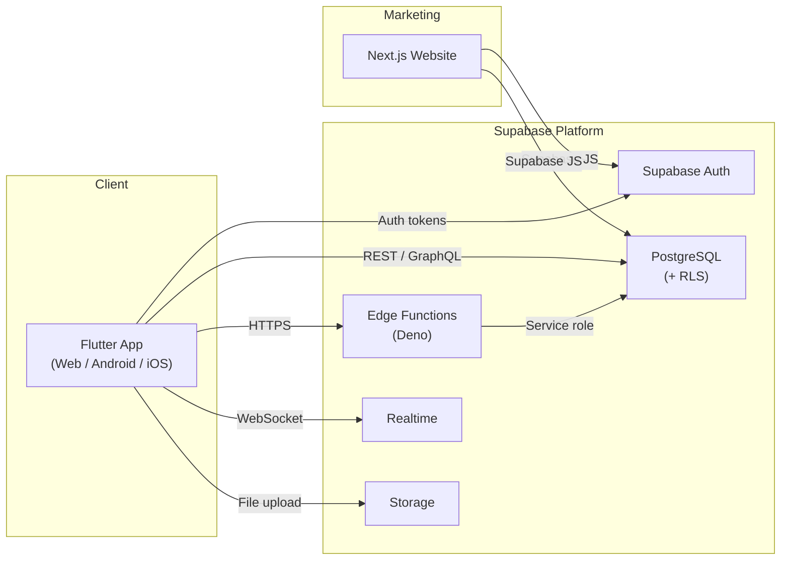
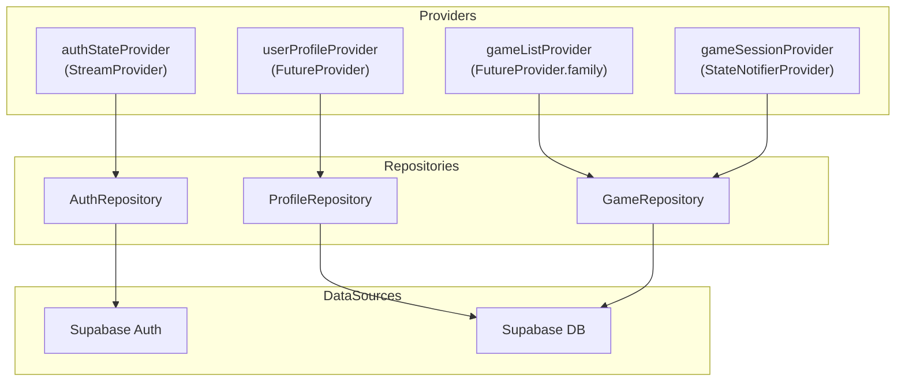
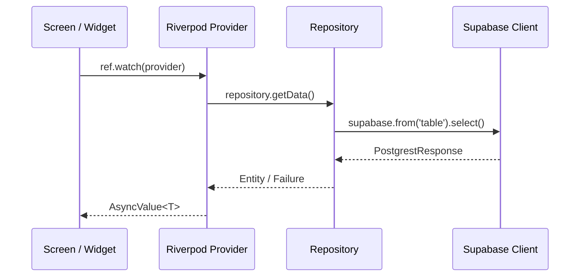
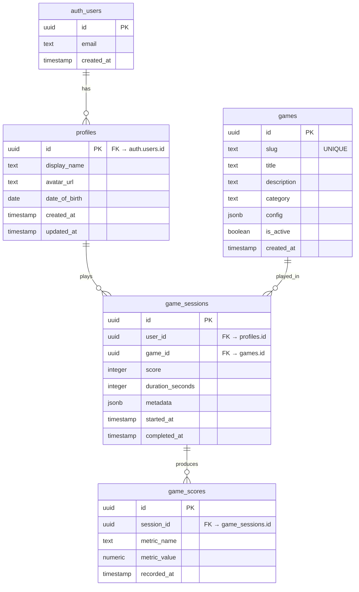
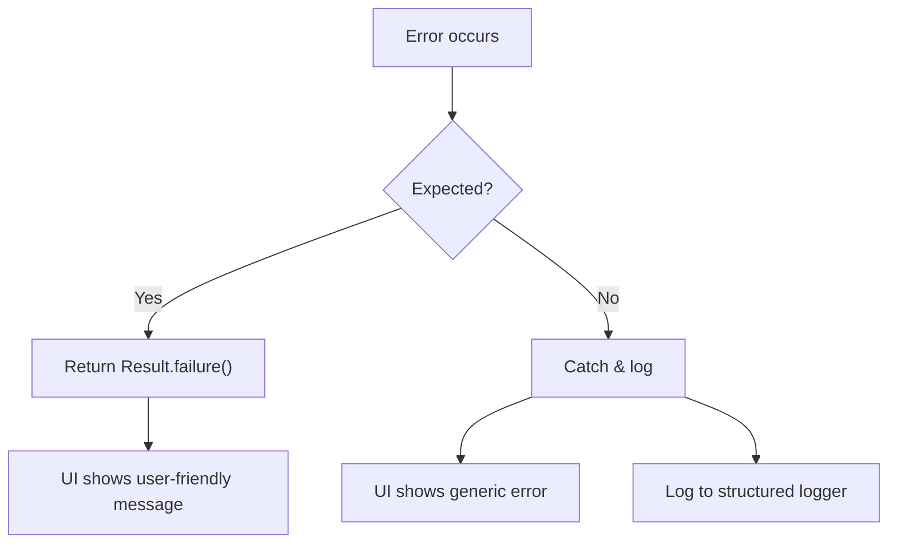
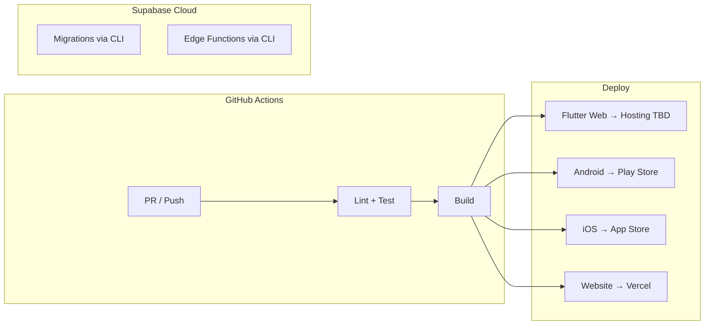

# NEUROPLAY — Architecture

> **Status**: Living document · Last updated: 2026-10-22

## 1. System Overview

NEUROPLAY is a cross-platform brain-training platform. The system comprises three deployable units:

1. **Flutter App** — A single Dart codebase compiled to Web (SPA), Android (APK/AAB), and iOS (IPA).
2. **Supabase Backend** — Managed PostgreSQL database, Auth service, Row-Level Security, Realtime subscriptions, Storage, and Edge Functions.
3. **Next.js Marketing Website** — Server-rendered public site with landing pages, blog, and pricing.



## 2. Flutter App Architecture

### 2.1 Layered Architecture

The app follows a **feature-first** structure with a clean separation into three layers per feature:

```
lib/
├── main.dart
├── app/
│   ├── app.dart                  # MaterialApp.router setup
│   ├── router.dart               # GoRouter configuration
│   ├── theme.dart                # ThemeData (Material 3)
│   └── providers.dart            # App-wide Riverpod providers
├── features/
│   ├── auth/
│   │   ├── data/
│   │   │   ├── auth_repository.dart
│   │   │   └── auth_dto.dart
│   │   ├── domain/
│   │   │   ├── user_entity.dart
│   │   │   └── auth_state.dart
│   │   └── presentation/
│   │       ├── login_screen.dart
│   │       ├── register_screen.dart
│   │       └── auth_provider.dart
│   ├── onboarding/
│   ├── home/
│   ├── games/
│   │   ├── data/
│   │   ├── domain/
│   │   └── presentation/
│   │       ├── game_list_screen.dart
│   │       ├── game_play_screen.dart
│   │       └── game_result_screen.dart
│   └── profile/
├── core/
│   ├── constants.dart
│   ├── extensions/
│   ├── exceptions/
│   │   ├── app_exception.dart    # Sealed exception hierarchy
│   │   └── failure.dart          # Result type / Failure class
│   ├── network/
│   │   └── supabase_client.dart  # Singleton Supabase init
│   └── utils/
│       ├── logger.dart
│       └── validators.dart
└── l10n/
    ├── app_en.arb
    └── l10n.dart
```

### 2.2 State Management (Riverpod)



**Conventions:**
- `Provider` — immutable computed value.
- `FutureProvider` / `StreamProvider` — async data from repositories.
- `StateNotifierProvider` / `AsyncNotifierProvider` — mutable state with business logic.
- `Provider.family` — parameterized providers.
- All providers are declared in `<feature>/presentation/<feature>_provider.dart`.
- Providers depend on repository providers, never on other feature providers directly (use a shared `core` provider or pass via constructor).

### 2.3 Navigation (GoRouter)

```dart
// Simplified route structure
GoRouter(
  initialLocation: '/home',
  redirect: (context, state) => /* auth guard */,
  routes: [
    GoRoute(path: '/login', builder: ...),
    GoRoute(path: '/register', builder: ...),
    GoRoute(path: '/onboarding', builder: ...),
    ShellRoute(
      builder: /* AppShell with bottom nav */,
      routes: [
        GoRoute(path: '/home', builder: ...),
        GoRoute(path: '/games', builder: ...,
          routes: [
            GoRoute(path: ':gameId', builder: /* GamePlay */),
            GoRoute(path: ':gameId/result', builder: /* GameResult */),
          ],
        ),
        GoRoute(path: '/profile', builder: ...),
      ],
    ),
  ],
);
```

**Rules:**
- All routes defined in `app/router.dart`.
- Route paths are constants in `core/constants.dart`.
- Auth guard redirects unauthenticated users to `/login`.
- Deep linking is supported for all routes.

### 2.4 Data Flow



## 3. Database Architecture

### 3.1 Core Tables



### 3.2 Row-Level Security (RLS)

Every table has RLS enabled. Core policies:

| Table | SELECT | INSERT | UPDATE | DELETE |
|-------|--------|--------|--------|--------|
| `profiles` | Own row only | Auto via trigger | Own row only | Never |
| `games` | All (public) | Admin only | Admin only | Admin only |
| `game_sessions` | Own rows | Own rows | Own rows | Never |
| `game_scores` | Own rows (via session) | Via Edge Function | Never | Never |

### 3.3 Migrations

- All schema changes go through numbered migrations in `supabase/migrations/`.
- Naming: `YYYYMMDDHHMMSS_descriptive_name.sql`.
- Migrations are idempotent where possible.
- Seed data lives in `supabase/seed.sql`.

## 4. Supabase Edge Functions

Edge Functions handle trusted server-side operations:

| Function | Purpose | Auth Required |
|----------|---------|---------------|
| `submit-score` | Validates and records game scores | Yes (JWT) |
| `compute-stats` | Aggregates user performance stats | Yes (JWT) |
| `delete-account` | GDPR-compliant account deletion | Yes (JWT) |

**Conventions:**
- Each function lives in `supabase/functions/<name>/index.ts`.
- Functions validate JWT, extract user ID, perform operations with service role key.
- Consistent error response shape: `{ "error": { "code": "VALIDATION_ERROR", "message": "..." } }`.
- Functions are stateless and idempotent.

## 5. Marketing Website Architecture

```
website/
├── src/
│   ├── app/                    # Next.js App Router
│   │   ├── layout.tsx          # Root layout
│   │   ├── page.tsx            # Landing page
│   │   ├── pricing/page.tsx
│   │   ├── about/page.tsx
│   │   └── blog/
│   │       ├── page.tsx        # Blog index
│   │       └── [slug]/page.tsx # Blog post
│   ├── components/
│   │   ├── ui/                 # Reusable UI primitives
│   │   ├── layout/             # Header, Footer, Nav
│   │   └── sections/           # Landing page sections
│   └── lib/
│       ├── supabase.ts         # Supabase server client
│       └── utils.ts
├── public/
│   └── images/
├── tailwind.config.ts
├── next.config.ts
├── tsconfig.json
└── package.json
```

**Conventions:**
- Server Components by default; `"use client"` only when needed.
- Tailwind CSS for styling.
- SEO metadata in each page's `generateMetadata`.
- Images optimized with `next/image`.

## 6. Cross-Cutting Concerns

### 6.1 Error Handling Strategy



- **Dart**: Sealed `AppException` class hierarchy with `Result<T, Failure>` pattern.
- **TypeScript (Edge Functions)**: Try-catch with typed error codes.
- **TypeScript (Website)**: Next.js error boundaries + `error.tsx` per route.

### 6.2 Logging
- **App**: Structured logger wrapping `dart:developer` (debug) / future crash reporting (production).
- **Edge Functions**: `console.log` with JSON structure; Supabase captures logs.
- **Website**: Next.js built-in logging + structured console output.

### 6.3 Environment Configuration
- All secrets via `.env` files (never committed).
- `.env.example` files committed with placeholder key names.
- Runtime config read once at startup and injected via providers/config objects.
- Supabase anon key (public) is the only key permitted in client bundles.

## 7. Deployment Architecture



- **Flutter Web**: Static hosting (Vercel, Firebase Hosting, or Cloudflare Pages).
- **Android/iOS**: Built in CI, distributed via stores.
- **Website**: Vercel (automatic from `main` branch).
- **Supabase**: Migrations deployed via `supabase db push`; functions via `supabase functions deploy`.

## 8. Design Decisions Log

| # | Decision | Rationale | Date |
|---|----------|-----------|------|
| 1 | Feature-first folder structure | Scales better than layer-first as features grow | 2026-10-22 |
| 2 | Riverpod over Bloc/Provider | Compile-safe, testable, no BuildContext dependency | 2026-10-22 |
| 3 | GoRouter over Navigator 2.0 | Declarative, deep linking support, maintained by Flutter team | 2026-10-22 |
| 4 | Supabase over Firebase | Open-source, PostgreSQL, generous free tier, RLS | 2026-10-22 |
| 5 | Edge Functions for score submission | Prevents client-side score tampering | 2026-10-22 |
| 6 | pnpm over npm/yarn | Faster installs, strict dependency resolution, disk efficient | 2026-10-22 |
| 7 | Next.js App Router | Server components, streaming, latest stable patterns | 2026-10-22 |
