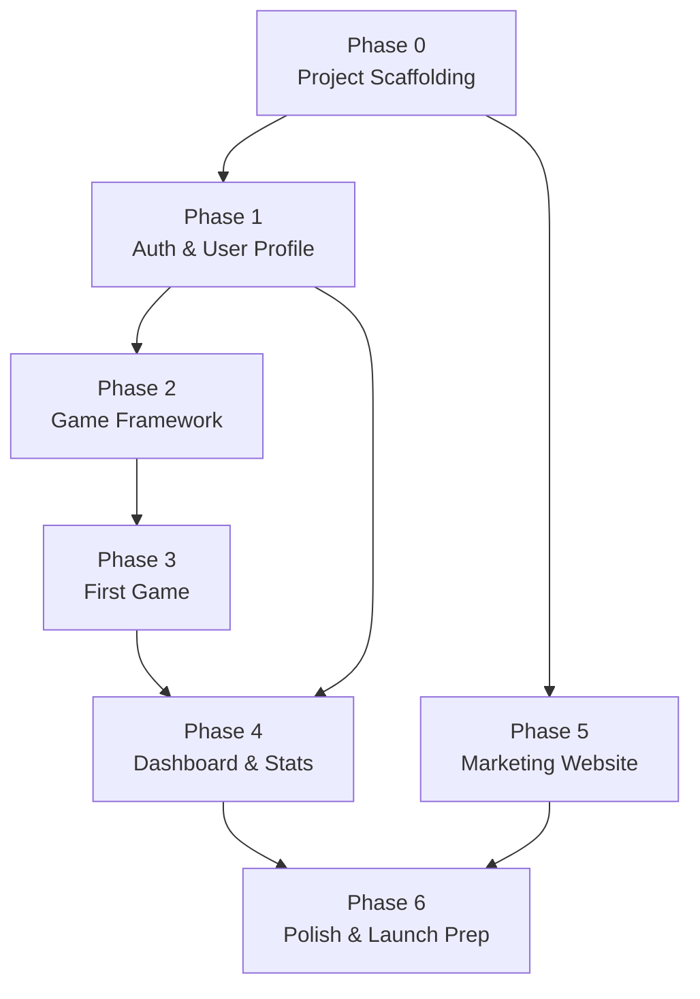

# NEUROPLAY — Implementation Plan

> **Status**: Living document · Last updated: 2026-10-22

## Overview

This plan defines a phased approach to building the NEUROPLAY MVP. Each phase has clear deliverables, acceptance criteria, and a dependency graph.

## Dependency Graph

---

## Phase 0 — Project Scaffolding

**Goal**: Establish repository structure, tooling, CI pipeline, and development environment.

### Deliverables

| # | Task | Output |
|---|------|--------|
| 0.1 | Initialize Git repository | `.git/`, `.gitignore`, `LICENSE` |
| 0.2 | Create Flutter project | `app/` with `pubspec.yaml`, analysis_options, basic `main.dart` |
| 0.3 | Add core dependencies | Riverpod, GoRouter, supabase_flutter in `pubspec.yaml` |
| 0.4 | Create Next.js project | `website/` with `package.json`, `tsconfig.json`, `next.config.ts` |
| 0.5 | Initialize Supabase project | `supabase/config.toml`, `supabase/migrations/`, `supabase/functions/` |
| 0.6 | Set up GitHub Actions | `flutter-ci.yml`, `website-ci.yml` |
| 0.7 | Create `.env.example` files | Root, `app/`, `website/` |
| 0.8 | Write foundational docs | `README.md`, `docs/architecture.md`, `docs/security.md`, this plan |
| 0.9 | Configure lint rules | `analysis_options.yaml` (Flutter), `eslint.config.mjs` (Next.js) |

### Acceptance Criteria

- [ ] `flutter analyze` passes with zero issues on `app/`.
- [ ] `flutter test` runs (even if trivial test).
- [ ] `pnpm build` succeeds in `website/`.
- [ ] `pnpm lint` passes in `website/`.
- [ ] GitHub Actions workflows parse correctly (valid YAML).
- [ ] `.env.example` files contain all required variable names with no real values.
- [ ] `README.md` accurately describes repo structure and setup steps.
- [ ] All docs exist and are internally consistent.

---

## Phase 1 — Authentication & User Profile

**Goal**: Users can register, log in, log out, and view/edit their profile.

**Depends on**: Phase 0

### Deliverables

| # | Task | Output |
|---|------|--------|
| 1.1 | Supabase Auth configuration | Email+password provider enabled |
| 1.2 | Database: `profiles` table + RLS | Migration `001_create_profiles.sql` |
| 1.3 | Database: trigger to auto-create profile | Migration `002_profile_trigger.sql` |
| 1.4 | `AuthRepository` | `features/auth/data/auth_repository.dart` |
| 1.5 | Auth providers | `authStateProvider`, `signInProvider`, `signUpProvider`, `signOutProvider` |
| 1.6 | Login screen | `features/auth/presentation/login_screen.dart` |
| 1.7 | Register screen | `features/auth/presentation/register_screen.dart` |
| 1.8 | Profile screen (view + edit) | `features/profile/` |
| 1.9 | GoRouter auth guard | Redirect to `/login` if unauthenticated |
| 1.10 | `ProfileRepository` | `features/profile/data/profile_repository.dart` |
| 1.11 | Unit tests for repositories | `test/features/auth/`, `test/features/profile/` |
| 1.12 | Widget tests for screens | At least 1 per screen |

### Acceptance Criteria

- [ ] User can register with email + password.
- [ ] User can log in and is redirected to `/home`.
- [ ] User can log out and is redirected to `/login`.
- [ ] User cannot access `/home` without authentication.
- [ ] User can view and edit display name on profile screen.
- [ ] `profiles` RLS tested: user cannot read another user's profile.
- [ ] All unit tests pass.
- [ ] All widget tests pass.
- [ ] `flutter analyze` passes.

---

## Phase 2 — Game Framework

**Goal**: Build the infrastructure that all cognitive games will use: game registry, session management, score submission.

**Depends on**: Phase 1

### Deliverables

| # | Task | Output |
|---|------|--------|
| 2.1 | Database: `games` table + seed data | Migration `003_create_games.sql` + `seed.sql` |
| 2.2 | Database: `game_sessions` table + RLS | Migration `004_create_game_sessions.sql` |
| 2.3 | Database: `game_scores` table + RLS | Migration `005_create_game_scores.sql` |
| 2.4 | Edge Function: `submit-score` | `supabase/functions/submit-score/index.ts` |
| 2.5 | `GameRepository` | `features/games/data/game_repository.dart` |
| 2.6 | Game list provider & screen | `features/games/presentation/game_list_screen.dart` |
| 2.7 | Abstract game interface | `features/games/domain/game_interface.dart` |
| 2.8 | Game session state management | `gameSessionProvider` (StateNotifier) |
| 2.9 | Game result screen | `features/games/presentation/game_result_screen.dart` |
| 2.10 | Unit tests | Repository + provider tests |
| 2.11 | Edge Function tests | `submit-score` validation tests |

### Acceptance Criteria

- [ ] Game list screen displays available games from database.
- [ ] Tapping a game starts a new `game_session` record.
- [ ] Score submitted via Edge Function (not direct DB insert).
- [ ] `submit-score` Edge Function validates JWT and score range.
- [ ] RLS: users can only see their own sessions.
- [ ] Game interface contract allows plugging in new game types.
- [ ] All tests pass.
- [ ] `flutter analyze` passes.

---

## Phase 3 — First Game (Reaction Time)

**Goal**: Implement one complete cognitive game to validate the game framework.

**Depends on**: Phase 2

### Deliverables

| # | Task | Output |
|---|------|--------|
| 3.1 | Game: Reaction Time | `features/games/presentation/games/reaction_time/` |
| 3.2 | Game logic | Measure tap response to stimulus; compute average reaction time |
| 3.3 | Seed data entry | Add "Reaction Time" to `games` table seed |
| 3.4 | Score submission integration | Submit reaction time score via `submit-score` |
| 3.5 | Result display | Show score, comparison to previous attempts |
| 3.6 | Widget tests | Test game UI states (waiting, stimulus, result) |
| 3.7 | Integration test | Full flow: start game → play → submit → view result |

### Acceptance Criteria

- [ ] Game displays stimulus after random delay.
- [ ] Tapping records reaction time accurately (±10ms).
- [ ] Score is submitted via Edge Function and persisted.
- [ ] Result screen shows current score and personal best.
- [ ] Game handles edge cases: tapping too early, navigating away mid-game.
- [ ] Widget tests cover all game states.
- [ ] Integration test completes full flow.

---

## Phase 4 — Dashboard & Statistics

**Goal**: Show users their training history and progress.

**Depends on**: Phase 3, Phase 1

### Deliverables

| # | Task | Output |
|---|------|--------|
| 4.1 | Home screen redesign | Dashboard with recent activity + stats summary |
| 4.2 | Edge Function: `compute-stats` | Aggregate scores by game, time period |
| 4.3 | Stats provider | `dashboardStatsProvider` |
| 4.4 | Charts / visualizations | Simple line chart of score trends (using `fl_chart` or similar) |
| 4.5 | Unit tests | Stats computation tests |
| 4.6 | Widget tests | Dashboard layout tests |

### Acceptance Criteria

- [x] Dashboard shows total games played, current streak, average scores.
- [x] Score trend chart displays correctly with real data.
- [x] Stats computed server-side via Edge Function and database aggregation RPC.
- [x] Empty state handled gracefully (new user, no games played).
- [x] All tests pass.

---

## Phase 5 — Marketing Website

**Goal**: Launch a public-facing website with landing page, features, and pricing information.

**Depends on**: Phase 0 (can run in parallel with Phases 1-4)

### Deliverables

| # | Task | Output |
|---|------|--------|
| 5.1 | Landing page | Hero section, feature highlights, CTA |
| 5.2 | About page | Mission, team, science behind brain training |
| 5.3 | Pricing page | Free tier details, future premium plans |
| 5.4 | Responsive layout | Mobile-first design |
| 5.5 | SEO metadata | Open Graph tags, structured data |
| 5.6 | Component tests | React Testing Library |
| 5.7 | Lighthouse audit | Performance ≥ 90, Accessibility ≥ 90 |

### Acceptance Criteria

- [ ] Landing page renders on mobile, tablet, and desktop.
- [ ] All pages have proper meta tags and titles.
- [ ] `pnpm build` produces no errors or warnings.
- [ ] Lighthouse scores: Performance ≥ 90, Accessibility ≥ 90, SEO ≥ 90.
- [ ] Component tests pass.
- [ ] No broken links.

---

## Phase 6 — Polish & Launch Preparation

**Goal**: Production hardening, final testing, app store preparation.

**Depends on**: Phase 4, Phase 5

### Deliverables

| # | Task | Output |
|---|------|--------|
| 6.1 | Account deletion (GDPR) | Edge Function `delete-account` + UI |
| 6.2 | Onboarding flow | `features/onboarding/` — first-time user walkthrough |
| 6.3 | Error reporting setup | Crash reporting integration (e.g., Sentry) |
| 6.4 | App icons & splash screen | Platform-specific assets |
| 6.5 | Privacy Policy & Terms | Pages on website + links in app |
| 6.6 | Performance optimization | Tree shaking, lazy loading, image optimization |
| 6.7 | Android release build | Signed AAB for Play Store |
| 6.8 | iOS release build | Archive for App Store |
| 6.9 | Web deployment | Deploy Flutter Web + Next.js to production hosting |
| 6.10 | End-to-end testing | Full user journey across all platforms |
| 6.11 | Security audit | Review RLS, secrets, CSP headers |

### Acceptance Criteria

- [ ] User can delete their account and all data is removed.
- [ ] Onboarding completes and does not show again.
- [ ] App launches without crashes on Android, iOS, and Web.
- [ ] Signed release builds produce valid APK/AAB and IPA.
- [ ] Flutter Web deployed and accessible via production URL.
- [ ] Marketing website deployed and accessible via production URL.
- [ ] All CI pipelines green.
- [ ] Privacy Policy and Terms of Service published.
- [ ] Final security checklist completed (see `docs/security.md`).

---

## Timeline Estimate

| Phase | Estimated Duration | Parallelizable With |
|-------|-------------------|-------------------|
| Phase 0 | 1–2 days | — |
| Phase 1 | 3–5 days | Phase 5 |
| Phase 2 | 3–5 days | Phase 5 |
| Phase 3 | 2–3 days | Phase 5 |
| Phase 4 | 3–4 days | Phase 5 |
| Phase 5 | 3–5 days | Phases 1–4 |
| Phase 6 | 3–5 days | — |
| **Total** | **~3–4 weeks** | |

> These estimates assume a single developer working full-time. Adjust based on team size and experience.

---

## Task Status Legend

| Symbol | Meaning |
|--------|---------|
| 🔲 | Not started |
| 🔧 | In progress |
| ✅ | Complete (code + tests) |
| ⛔ | Blocked |

## Current Status

| Phase | Status |
|-------|--------|
| Phase 0 — Scaffolding | 🔧 In progress |
| Phase 1 — Auth & Profile | 🔲 Not started |
| Phase 2 — Game Framework | 🔲 Not started |
| Phase 3 — First Game | 🔲 Not started |
| Phase 4 — Dashboard & Stats | 🔲 Not started |
| Phase 5 — Marketing Website | 🔲 Not started |
| Phase 6 — Polish & Launch | 🔲 Not started |
