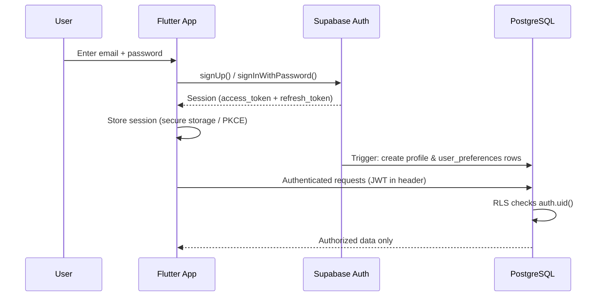

# NEUROPLAY — Security

> **Status**: Living document · Last updated: 2026-10-23

## 1. Threat Model Summary

| Threat | Mitigation |
|--------|-----------|
| Credential leakage | `.env` files excluded from Git; secrets injected via CI environment variables |
| Score tampering | Scores submitted through Edge Functions with server-side validation |
| Unauthorized data access | Row-Level Security (RLS) on all Supabase tables |
| Session hijacking | Supabase Auth JWT with short TTL + refresh tokens; HTTPS everywhere |
| XSS in Flutter Web | Flutter's DOM abstraction prevents direct DOM injection; CSP headers on hosting |
| SQL injection | Supabase client uses parameterized queries; no raw SQL from client |
| Dependency vulnerabilities | Automated `dependabot` / `pub outdated` checks in CI |
| Insecure direct object references | RLS policies enforce `auth.uid() = user_id` on all user-scoped tables |
| Cross-user privilege escalation | Explicit RLS policies blocking reads/writes for unowned rows |

## 2. Authentication Architecture

### 2.1 Auth Flow



### 2.2 Supported Auth Methods (MVP)

| Method | Status | Notes |
|--------|--------|-------|
| Email + Password | ✅ MVP | Primary auth method with email confirmation |
| Password Reset Flow | ✅ MVP | Secure email token callback via deep link |
| Guest Experience | ✅ MVP | Ephemeral local session; zero server footprint |
| Magic Link (Email) | 🔲 Phase 2 | Passwordless option |
| Google OAuth | 🔲 Phase 2 | Social login |
| Apple Sign-In | 🔲 Phase 2 | Required for iOS App Store |

### 2.3 Guest Mode & Data Isolation Policy

- **Ephemeral In-Memory State**: Guests operate without an `auth.users` database entry. No fake or placeholder user rows are created in Supabase.
- **No False Migration Promises**: Guests are explicitly informed on the UI (Profile screen and workout flows) that their scores and settings are volatile and tied only to the current device session. The app does NOT promise or imply automatic migration of guest data to a registered account unless a dedicated migration backend flow is built, validated, and tested.
- **Zero Server Exposure**: All RLS policies reject unauthenticated requests (`auth.uid() IS NULL`), ensuring guest sessions can never query private database tables.

### 2.4 Platform Deep Linking & Redirect Security

To prevent open-redirect vulnerabilities and OAuth/magic-link interception, redirect URLs are strictly whitelisted and use standard platform deep link schemes:

1. **Native Mobile URL Scheme**:
   - Scheme: `neuroplay://auth-callback`
   - **Android (`AndroidManifest.xml`)**:
     ```xml
     <intent-filter>
         <action android:name="android.intent.action.VIEW" />
         <category android:name="android.intent.category.DEFAULT" />
         <category android:name="android.intent.category.BROWSABLE" />
         <data android:scheme="neuroplay" android:host="auth-callback" />
     </intent-filter>
     ```
   - **iOS (`Info.plist`)**:
     ```xml
     <key>CFBundleURLTypes</key>
     <array>
         <dict>
             <key>CFBundleTypeRole</key>
             <string>Editor</string>
             <key>CFBundleURLSchemes</key>
             <array>
                 <string>neuroplay</string>
             </array>
         </dict>
     </array>
     ```

2. **Web Redirects**:
   - Base URL: `https://neuroplay.app/`
   - Local Dev: `http://localhost:3000`, `http://localhost:5000`

3. **PKCE Flow (Proof Key for Code Exchange)**:
   - Supabase Flutter uses PKCE flow by default for all auth callbacks. The code verifier is stored securely in memory/local storage and exchanged over HTTPS, mitigating code interception attacks.

### 2.5 Token Management

- **Access Token**: JWT, short-lived (default 1 hour).
- **Refresh Token**: Long-lived, stored in platform-secure storage:
  - **Android/iOS**: `flutter_secure_storage` (Keychain / EncryptedSharedPreferences).
  - **Web**: Supabase PKCE local storage with automatic token refresh.
- **Token Refresh**: Handled automatically in background by `supabase_flutter` SDK.
- **Sign Out**: In-memory user state (profile, preferences, cached workout history) is immediately cleared via Riverpod cache invalidation, and the Supabase session is revoked server-side.

## 3. Data Security & RLS

### 3.1 Row-Level Security (RLS) Policies

All application tables have RLS **enabled**. The `service_role` key is **never** bundled in client applications.

#### `public.profiles` Table
```sql
-- Users can view only their own profile
CREATE POLICY "Users can view own profile"
  ON public.profiles FOR SELECT
  USING (auth.uid() = id);

-- Users can update only their own profile
CREATE POLICY "Users can update own profile"
  ON public.profiles FOR UPDATE
  USING (auth.uid() = id)
  WITH CHECK (auth.uid() = id);

-- Creation handled by PostgreSQL security-definer trigger
-- Client direct inserts and deletes are disallowed
```

#### `public.user_preferences` Table
```sql
-- Users can view only their own preferences
CREATE POLICY "Users can view own preferences"
  ON public.user_preferences FOR SELECT
  USING (auth.uid() = user_id);

-- Users can update only their own preferences
CREATE POLICY "Users can update own preferences"
  ON public.user_preferences FOR UPDATE
  USING (auth.uid() = user_id)
  WITH CHECK (auth.uid() = user_id);

-- Creation handled by PostgreSQL security-definer trigger
-- Client direct inserts and deletes are disallowed
```

#### Automated User Provisioning Trigger
When a user confirms registration in Supabase Auth, a PostgreSQL `SECURITY DEFINER` function `public.handle_new_user()` executes on `AFTER INSERT ON auth.users` to automatically populate default records in `public.profiles` and `public.user_preferences`.

### 3.2 Data Classification

| Classification | Examples | Storage | Access |
|---------------|----------|---------|--------|
| **Public** | Game metadata, marketing content | PostgreSQL, CDN | Anyone |
| **Private** | User profile, preferences, game history | PostgreSQL (RLS) | Owner only |
| **Sensitive** | Email address, hashed credentials | Supabase Auth (`auth.users`) | Supabase Auth internal |
| **Secret** | Service role key, DB connection password | CI secrets / Supabase dashboard | Backend / Edge Functions only |

## 4. Secret Management

### 4.1 Secret Categories

| Secret | Used By | Storage | Exposure Risk |
|--------|---------|---------|---------------|
| `SUPABASE_URL` | App, Website, Edge Functions | `.env` | Public / Client-safe |
| `SUPABASE_ANON_KEY` | App, Website | `.env` | Public / Protected by RLS |
| `SUPABASE_SERVICE_ROLE_KEY` | Edge Functions only | Supabase Secrets Vault / CI | **CRITICAL** - Bypasses RLS |
| `SUPABASE_DB_PASSWORD` | CI Migrations | CI Secrets | **CRITICAL** - Direct DB access |
| `SUPABASE_PROJECT_ID` | CLI Operations | CI Secrets | Metadata |

### 4.2 Rules
1. **Never commit `.env` files** — only `.env.example` with placeholder names.
2. **Never embed `service_role` key in client bundles** — it completely bypasses RLS policies.
3. **`SUPABASE_ANON_KEY` is client-safe** — permissions are strictly restricted by Postgres RLS.
4. **Compile-time flags**: Flutter uses `--dart-define=SUPABASE_URL=...` and `--dart-define=SUPABASE_ANON_KEY=...`.
5. **Edge Function Secrets**: Set securely in Supabase environment using `supabase secrets set SUPABASE_SERVICE_ROLE_KEY=...`.

## 5. Network Security

- **HTTPS everywhere**: All Supabase REST, Auth, and Edge Function endpoints enforce TLS 1.3.
- **CORS configuration**: Dashboard configured for allowed origins only (`https://neuroplay.app`, localhost during dev).
- **CSP Headers**: Flutter Web deployment specifies Content-Security-Policy headers restricting script execution.

## 6. Input Validation & Error Handling

- **Client Validation**: Dart form validators enforce minimum password length (>= 8 chars), valid email formatting, and required fields before network calls.
- **Sanitized Errors**: Raw database exceptions or stack traces are never shown to users. They are mapped into typed `AppException` / `Failure` instances with human-friendly, secure messages.

## 7. Privacy, Compliance & Data Retention

### 7.1 Data Minimization
- No personal identifiers beyond email and chosen display name.
- No device location tracking or contacts access.

### 7.2 Account Deletion & Data Retention Policy (GDPR / CCPA / App Store)

NEUROPLAY implements a trusted, server-side account deletion workflow:
1. **Execution via Edge Function**: The client invokes the `delete-account` Supabase Edge Function with its active bearer JWT.
2. **Identity Verification**: The Edge Function validates the caller's JWT using `supabase.auth.getUser()`, extracting the verified `user.id`.
3. **Administrative Erasure**: Using the server-side `SUPABASE_SERVICE_ROLE_KEY`, the function calls `auth.admin.deleteUser(user.id)`.
4. **PostgreSQL Cascade Erasure**:
   - `auth.users(id)` deletion triggers `ON DELETE CASCADE` across foreign keys in:
     - `public.profiles` (`id -> auth.users.id`)
     - `public.user_preferences` (`user_id -> auth.users.id`)
     - `public.game_sessions` (`user_id -> profiles.id`)
     - `public.game_scores` (`session_id -> game_sessions.id`)
5. **Immediate Retention Guarantee**: All personal profile records, settings, and gameplay metrics are immediately and permanently purged from active PostgreSQL storage. No shadow accounts, soft-deletes, or orphaned user rows are maintained.

## 8. Integration & Policy Testing

Row-Level Security and foreign key cascade rules are verified via automated SQL test scripts in `supabase/tests/rls_unauthorized_access_test.sql`:
- ✅ Anonymous users cannot SELECT or INSERT into profiles or preferences.
- ✅ Authenticated users cannot view or modify other users' profiles or preferences.
- ✅ Deleting an `auth.users` row cascades cleanly to profiles and preferences.
