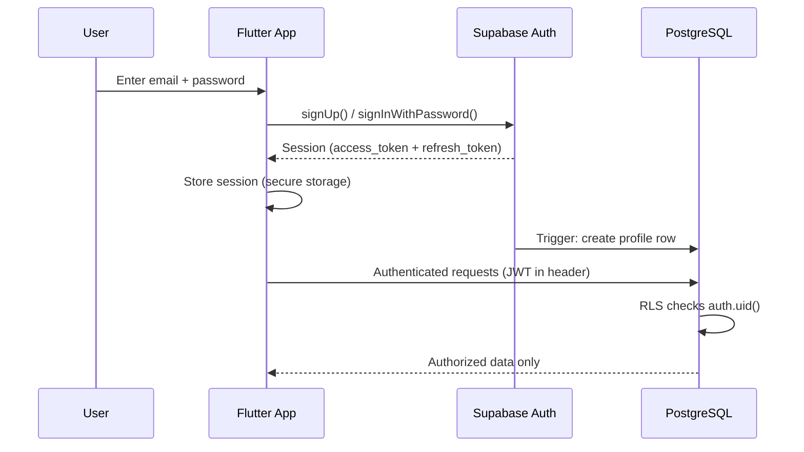

# NEUROPLAY — Security

> **Status**: Living document · Last updated: 2026-10-22

## 1. Threat Model Summary

| Threat | Mitigation |
|--------|-----------|
| Credential leakage | `.env` files excluded from Git; secrets injected via CI environment variables |
| Score tampering | Scores submitted through Edge Functions with server-side validation |
| Unauthorized data access | Row-Level Security (RLS) on all Supabase tables |
| Session hijacking | Supabase Auth JWT with short TTL + refresh tokens; HTTPS everywhere |
| XSS in Flutter Web | Flutter's DOM abstraction prevents direct DOM injection; CSP headers on hosting |
| SQL injection | Supabase client uses parameterized queries; no raw SQL from client |
| Dependency vulnerabilities | Automated `dependabot` / `pub outdated` checks in CI |
| Insecure direct object references | RLS policies enforce `auth.uid() = user_id` on all user-scoped tables |

## 2. Authentication Architecture

### 2.1 Auth Flow



### 2.2 Supported Auth Methods (MVP)

| Method | Status | Notes |
|--------|--------|-------|
| Email + Password | ✅ MVP | Primary auth method |
| Magic Link (Email) | 🔲 Phase 2 | Passwordless option |
| Google OAuth | 🔲 Phase 2 | Social login |
| Apple Sign-In | 🔲 Phase 2 | Required for iOS |

### 2.3 Token Management

- **Access Token**: JWT, short-lived (default 1 hour).
- **Refresh Token**: Long-lived, stored in platform-secure storage.
  - **Android/iOS**: `flutter_secure_storage` (Keychain / EncryptedSharedPreferences).
  - **Web**: HttpOnly cookie (via Supabase PKCE flow) or secure in-memory storage.
- **Token Refresh**: Handled automatically by `supabase_flutter` SDK.
- **Logout**: Invalidates refresh token server-side + clears local storage.

## 3. Data Security

### 3.1 Row-Level Security (RLS) Policies

All tables have RLS **enabled**. The `service_role` key is **never** exposed to clients.

#### `profiles` Table
```sql
-- Users can read only their own profile
CREATE POLICY "Users can view own profile"
  ON profiles FOR SELECT
  USING (auth.uid() = id);

-- Users can update only their own profile
CREATE POLICY "Users can update own profile"
  ON profiles FOR UPDATE
  USING (auth.uid() = id)
  WITH CHECK (auth.uid() = id);

-- Profile created automatically via trigger on auth.users insert
CREATE POLICY "Service can insert profile"
  ON profiles FOR INSERT
  WITH CHECK (auth.uid() = id);
```

#### `games` Table
```sql
-- Anyone authenticated can read games
CREATE POLICY "Authenticated users can view games"
  ON games FOR SELECT
  USING (auth.role() = 'authenticated');
```

#### `game_sessions` Table
```sql
-- Users can only see and create their own sessions
CREATE POLICY "Users manage own sessions"
  ON game_sessions FOR ALL
  USING (auth.uid() = user_id)
  WITH CHECK (auth.uid() = user_id);
```

#### `game_scores` Table
```sql
-- Users can read their own scores
CREATE POLICY "Users can view own scores"
  ON game_scores FOR SELECT
  USING (
    EXISTS (
      SELECT 1 FROM game_sessions
      WHERE game_sessions.id = game_scores.session_id
      AND game_sessions.user_id = auth.uid()
    )
  );

-- Only Edge Functions (service role) can insert scores
-- No client-side insert policy
```

### 3.2 Data Classification

| Classification | Examples | Storage | Access |
|---------------|----------|---------|--------|
| **Public** | Game metadata, marketing content | PostgreSQL, CDN | Anyone |
| **Private** | User profile, game history | PostgreSQL (RLS) | Owner only |
| **Sensitive** | Email, date of birth | PostgreSQL (RLS) | Owner only |
| **Secret** | Service role key, JWT secret | CI environment variables | Backend only |

## 4. Secret Management

### 4.1 Secret Categories

| Secret | Used By | Storage |
|--------|---------|---------|
| `SUPABASE_URL` | App, Website, Edge Functions | `.env` (client-safe, public) |
| `SUPABASE_ANON_KEY` | App, Website | `.env` (client-safe, public) |
| `SUPABASE_SERVICE_ROLE_KEY` | Edge Functions only | CI secrets / Supabase dashboard |
| `SUPABASE_DB_PASSWORD` | Migrations only | CI secrets |
| `SUPABASE_PROJECT_ID` | CLI operations | CI secrets |
| `NEXTAUTH_SECRET` | Website (if using NextAuth) | CI secrets |

### 4.2 Rules

1. **Never commit `.env` files** — only `.env.example` with placeholder names.
2. **Never embed `service_role` key in client bundles** — it bypasses RLS.
3. **`SUPABASE_ANON_KEY` is safe for client bundles** — it's scoped by RLS.
4. **CI secrets** are set in GitHub Actions repository settings → Secrets.
5. **Edge Function secrets** are set via `supabase secrets set KEY=value`.
6. **Dart `--dart-define`** or `--dart-define-from-file` for compile-time config.
7. **Next.js** uses `NEXT_PUBLIC_` prefix only for client-safe variables.

### 4.3 .gitignore Requirements

The following patterns MUST be in `.gitignore`:
```
.env
.env.local
.env.*.local
*.keystore
*.jks
*.p12
*.key
google-services.json
GoogleService-Info.plist
```

## 5. Network Security

- **HTTPS only**: All Supabase endpoints are HTTPS by default.
- **CORS**: Supabase dashboard configured for allowed origins only.
- **Rate Limiting**: Supabase provides built-in rate limiting; Edge Functions should add per-user throttling for sensitive operations.
- **CSP Headers**: Flutter Web deployment must include Content-Security-Policy headers.
- **HSTS**: Enabled on all production domains.

## 6. Input Validation

### 6.1 Client-Side (Flutter)
- Form validation using Dart validators (`core/utils/validators.dart`).
- Sanitize display names (strip HTML, limit length).
- Validate email format before sending to Auth.

### 6.2 Server-Side (Edge Functions)
- Validate all incoming request bodies against expected schema.
- Reject unknown fields.
- Validate score ranges against game configuration.
- Type-check all parameters.

### 6.3 Database Level
- Column constraints (NOT NULL, CHECK, UNIQUE).
- Foreign key constraints with appropriate ON DELETE behavior.
- Trigger-based validation for complex rules.

## 7. Privacy & Compliance

### 7.1 Data Minimization
- Collect only what is needed: email, display name, game scores.
- Date of birth is optional (for age-appropriate content).
- No location tracking. No contact list access.

### 7.2 Account Deletion (GDPR / App Store)
- Users can delete their account via the `delete-account` Edge Function.
- Cascades: deletes profile, game sessions, game scores.
- Auth record removed from `auth.users`.
- Confirmation required before deletion.

### 7.3 Data Export
- Phase 2 feature: users can export their data as JSON.

## 8. Dependency Security

- **Dart**: Run `dart pub outdated` and `dart pub audit` in CI.
- **Node**: Run `pnpm audit` in CI.
- **GitHub Dependabot**: Enabled for both Dart and Node dependency manifests.
- **Lock files committed**: `pubspec.lock` and `pnpm-lock.yaml` are committed to ensure reproducible builds and known-good dependency trees.

## 9. Security Checklist for Each Phase

- [ ] RLS policies written and tested for all new tables
- [ ] No service role key in client code
- [ ] `.env.example` updated with new variable names (no values)
- [ ] Input validation on both client and server
- [ ] Error messages don't leak implementation details
- [ ] New Edge Functions validate JWT before processing
- [ ] Dependencies audited (`pub audit`, `pnpm audit`)
- [ ] HTTPS enforced for all new endpoints
